  
  
  
  <a href="https://github.com/jihandong">
    <picture>
      <source media="(prefers-color-scheme: dark)" srcset="https://cdn.jsdelivr.net/gh/jihandong/jihandong@output/github-contribution-grid-snake-dark.svg">
      <source media="(prefers-color-scheme: light)" srcset="https://cdn.jsdelivr.net/gh/jihandong/jihandong@output/github-contribution-grid-snake.svg">
      
    </picture>
  </a>

